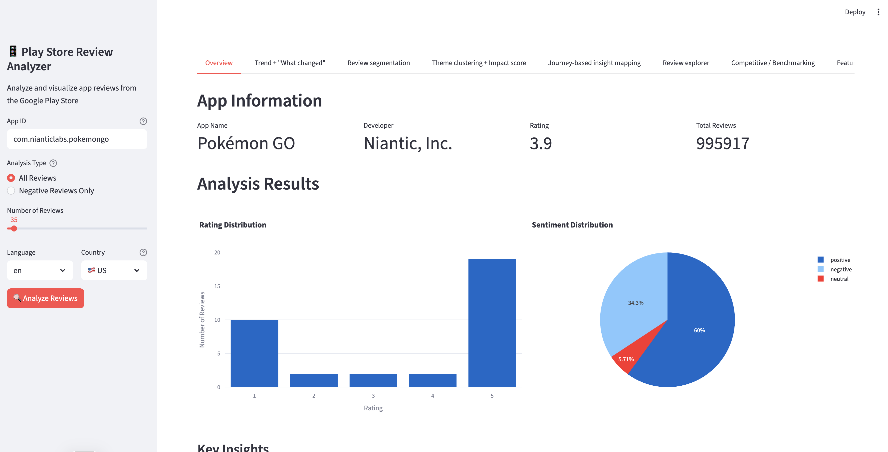

# Play Store App Review Analysis Tool



This tool helps analyze Google Play Store app reviews to support better design decision-making. It combines quantitative and qualitative analysis, user research, and sentiment analysis to generate actionable insights.

**Copyright © 2026 [Biswarup Mondal](https://www.biswarupmondal.com)**

## AI Model Support

Bring your own model. The new backend supports **Anthropic (Claude)**, **OpenAI**, **Google Gemini**, **OpenRouter**, **Groq**, **Mistral**, **Ollama** (local) and any **OpenAI-compatible** server. You pick the provider and model and paste your key in the app; nothing has to go in `.env`.

## New Backend API (in development)

A FastAPI backend is replacing the Streamlit app. It analyzes reviews in parallel batches (about a minute for 1,000 reviews instead of 30+), stores results in a local SQLite database (`data/app.db`), and reports live progress.

```bash
python -m venv .venv && source .venv/bin/activate
pip install -r requirements.txt
uvicorn backend.main:app --reload --port 8000
```

Interactive API docs: `http://localhost:8000/docs`. Import analyses from the old version with `python -m backend.cli import-legacy`.

What it returns for each analysis:
- **Problem board:** themes ranked by impact (reach × negativity × momentum) with real review quotes
- **Feedback type, journey stage and emotion** for every review
- **Trends:** rating and sentiment over time, 1★ spike detection, before/after a release, trending themes
- **Review explorer:** filter by rating, theme, type, version, date or text
- **Metrics API:** one set of definitions shared by the dashboard and the upcoming chat assistant
- **Chart images** (PNG/SVG, rendered with matplotlib) for reports

API keys are optional in `.env` as a fallback (`ANTHROPIC_API_KEY`, `OPENAI_API_KEY`, `GEMINI_API_KEY`, `OPENROUTER_API_KEY`, `GROQ_API_KEY`, `MISTRAL_API_KEY`). Keys pasted in the app are kept in memory only and never stored.

Run the tests with `pytest` (offline, no keys needed).

## Installation

1. Clone this repository:
```bash
git clone https://github.com/ux-biswarup/google-play-scrapper-for-designers.git
cd google-play-scrapper-for-designers
```

2. Install the required dependencies:
```bash
pip install -r requirements.txt
```

3. Set up your API key:
   - Copy `.env.example` to `.env`:
     ```bash
     cp .env.example .env
     ```
   - Get your Anthropic API key from [https://console.anthropic.com/](https://console.anthropic.com/)
   - Open `.env` and replace `your_api_key_here` with your actual API key:
     ```
     ANTHROPIC_API_KEY=sk-ant-api03-...
     ```

**Important:** Never commit your `.env` file to version control! It's already in `.gitignore` for your protection.

## Usage

### Web Interface (Recommended)

Run the Streamlit web interface:
```bash
streamlit run frontend/app.py
```

Then open your browser to `http://localhost:8501` and use the interactive interface.

### Python API

### Basic Usage

```python
from app_review_analyzer import PlayStoreReviewAnalyzer

# Initialize the analyzer with an app ID
analyzer = PlayStoreReviewAnalyzer("com.example.app")

# Fetch app information
app_info = analyzer.fetch_app_info()

# Fetch reviews (default: 1000 reviews)
reviews_df = analyzer.fetch_reviews(count=100)

# Generate a comprehensive report
report_path = analyzer.generate_report()
```

### Example

```python
# Example with Pokémon GO app
analyzer = PlayStoreReviewAnalyzer("com.nianticlabs.pokemongo")
analyzer.fetch_app_info()
analyzer.fetch_reviews(count=100)
report_path = analyzer.generate_report()
print(f"Report generated at: {report_path}")
```

## Output

The tool generates:
1. A JSON report containing:
   - App information
   - Review statistics
   - Sentiment distribution
   - Common topics
2. A visualization of the rating distribution

Reports are saved in the `reports` directory by default.

## Features Status

| Feature | Status |
|---------|--------|
| Automated review scraping | ✅ Done |
| Sentiment analysis (Anthropic) | ✅ Done |
| Topic analysis | ✅ Done |
| Report generation (JSON) | ✅ Done |
| Sentiment visualization | ✅ Done |
| Interactive web interface | ✅ Done |
| Trend + "What changed" analysis | 🚧 In Progress |
| Review segmentation | 🔜 Coming Soon |
| Theme clustering + Impact score | 🔜 Coming Soon |
| Journey-based insight mapping | 🔜 Coming Soon |
| Review explorer with smart filters | 🔜 Coming Soon |
| Competitive benchmarking | 🔜 Coming Soon |
| Review classification (bug/feature/UX) | 🔜 Coming Soon |
| Emotion detection | 🔜 Coming Soon |
| Auto-generated UX Research Report | 🔜 Coming Soon |
| Design decision helper | 🔜 Coming Soon |
| OpenAI integration | 🔜 Coming Soon |
| Local model support (Ollama) | 🔜 Coming Soon |

## Coming Soon Features

Stay tuned for these exciting features that will make this tool even more powerful for UX research and product teams:

### 1) Trend + "What changed" (Most Valuable) 🚧 In Progress

Right now it's a snapshot. Add **time-based insights** so teams can detect problems early.

✅ Add:
* **Rating trend over time** (daily / weekly)
* **Sentiment trend over time**
* **Spike detection** (sudden increase in 1★ reviews)
* **Before vs After update comparison** (e.g. v2.2.1 vs v2.2.0)
* **Top issues trending this week** (not just overall)

💡 UX value: Helps answer → *"Did this new update break something?"*

---

### 2) Review Segmentation (Gold for Research)

Not all users are the same. Segmenting makes insights *10x more actionable*.

✅ Segment by:
* Rating group (1★ vs 2★ vs 5★)
* Country & Language
* App version (if available)
* Device type / OS version (if available)
* "New vs returning users" proxy (repeat reviewers)

💡 UX value: Helps answer → *"Is this issue only happening to Android 14 users in India?"*

---

### 3) Theme Clustering + Impact Score (Prioritization Layer)

Your "common topics" is great, but teams need: **what to fix first**.

✅ Add:
* **Auto-clustered themes** (Login, Performance, Ads, Payments, UI, Bugs)
* **Impact Score** = frequency × negativity × recency
* **Effort tag** (manual input by PM/UX) → quick wins vs long fixes
* "Top 5 opportunity areas this week"

💡 UX value: Helps answer → *"What's the biggest UX pain right now?"*

---

### 4) Journey-Based Insight Mapping (UX Research Style)

Convert reviews into **UX journey steps**, like real research synthesis.

✅ Add:
* Funnel buckets:
  **Onboarding → Login → Core task → Payment → Support → Retention**
* "Most hated stage" ranking
* Stage-wise sentiment

💡 UX value: Helps answer → *"Users are dropping at onboarding because OTP fails."*

---

### 5) Review Explorer with Smart Filters (Researcher-Friendly)

A researcher needs to **read real verbatims fast**.

✅ Add:
* Search bar (keyword like "OTP", "lag", "refund")
* Filters: rating, sentiment, topic, date range
* Highlighted keywords inside reviews
* "Representative quotes" per theme (top 3–5 examples)

💡 UX value: Helps turn insights into **real user quotes for case studies + reports**

---

### 6) Competitive / Benchmarking Layer (Super Advanced)

This makes it instantly valuable for product teams.

✅ Add:
* Compare with competitor app IDs
* Compare sentiment share / top complaints
* "You vs Competitors" scorecard:
  * Avg rating
  * Most common issue
  * Recent sentiment trend

💡 UX value: Helps answer → *"Are users complaining about the same thing in competitor apps too?"*

---

### 7) "Feature Request vs Bug vs Complaint" Classification

Not all negative reviews mean bugs.

✅ Add:
* Auto-label reviews into:
  * **Bug**
  * **Feature request**
  * **UX confusion**
  * **Performance**
  * **Pricing/Ads complaint**
* Separate issue backlog from feature ideas

💡 UX value: Helps product decide **what to fix vs what to build**

---

### 8) Emotion Detection (Deep Qualitative Layer)

Sentiment is good, but emotions show urgency.

✅ Add:
* Emotion tags: anger, frustration, confusion, happiness, excitement
* "Most frustrated topics"
* "Most loyal users praising" signals

💡 UX value: Helps identify **high-risk moments** and **delight moments**

---

### 9) Auto-Generated UX Research Report (1-Click Export)

This will make your tool feel "enterprise-level".

✅ Add:
* Summary insights (Top issues + Top opportunities)
* Key quotes
* Impact score table
* Suggested UX actions
* Export to PDF / Notion / Google Doc

💡 UX value: Saves hours of synthesis work.

---

### 10) Design Decision Helper (Action → Recommendation)

This is where it becomes a "UX decision system" instead of analytics.

✅ Add:
* For each theme:
  **Problem → Evidence → Recommendation → Expected impact**
* "Suggested product improvements" cards
* Severity labels: Critical / High / Medium / Low

Example:
* **Issue:** Lag after update
* **Evidence:** 18% of 1★ reviews mention "lag" last 7 days
* **Recommendation:** Optimize loading + reduce background tasks
* **Impact:** Rating expected +0.2

---

## Configuration

### Environment Variables

The following environment variables are required:

- `ANTHROPIC_API_KEY`: Your Anthropic API key for Claude AI sentiment analysis
  - Get it from: https://console.anthropic.com/
  - Required for sentiment analysis functionality

### Optional Configuration

You can customize the default language and country by modifying the `PlayStoreReviewAnalyzer` initialization:
```python
analyzer = PlayStoreReviewAnalyzer(
    app_id="com.example.app",
    lang="en",      # Language code (default: 'en')
    country="us"    # Country code (default: 'us')
)
```

## Security Notes

- **Never commit your `.env` file** - it contains sensitive API keys
- The `.env` file is already in `.gitignore` to prevent accidental commits
- Always use environment variables for sensitive data
- If you accidentally commit a `.env` file, rotate your API keys immediately

## Troubleshooting

### "ANTHROPIC_API_KEY not found" Error

Make sure you have:
1. Created a `.env` file from `.env.example`
2. Added your API key to the `.env` file
3. The `.env` file is in the project root directory

### API Rate Limits

If you encounter rate limit errors, consider:
- Reducing the number of reviews analyzed
- Adding delays between API calls
- Using a higher-tier API plan

## Contributing

Contributions are welcome!

### Quick Start for Contributors

1. Fork the repository
2. Clone your fork and set up the development environment
3. Create a feature branch
4. Make your changes
5. **Ensure `.env` is not committed** (it's in `.gitignore` by default)
6. Submit a pull request

### Pre-commit Hook (Recommended)

To automatically prevent committing `.env` files, set up the pre-commit hook:

```bash
cp .github/pre-commit-hook.sh .git/hooks/pre-commit
chmod +x .git/hooks/pre-commit
```

## License

This project is open source. Please check the LICENSE file for details.

---

**Copyright © 2026 [Biswarup Mondal](https://www.biswarupmondal.com)**
