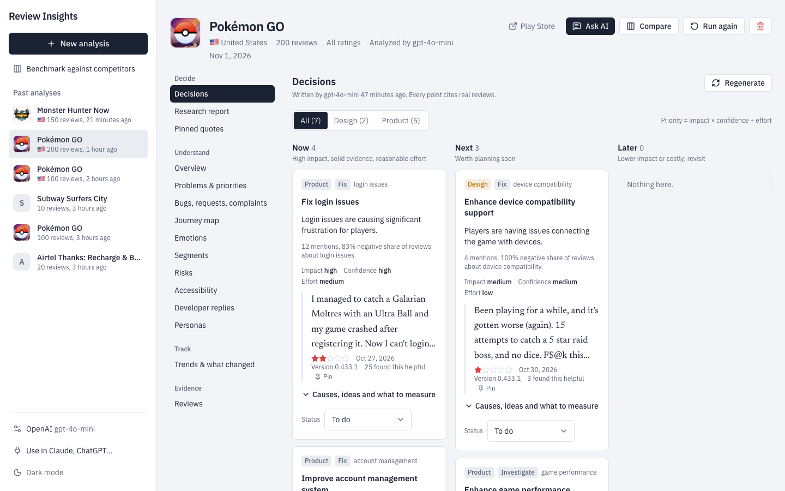
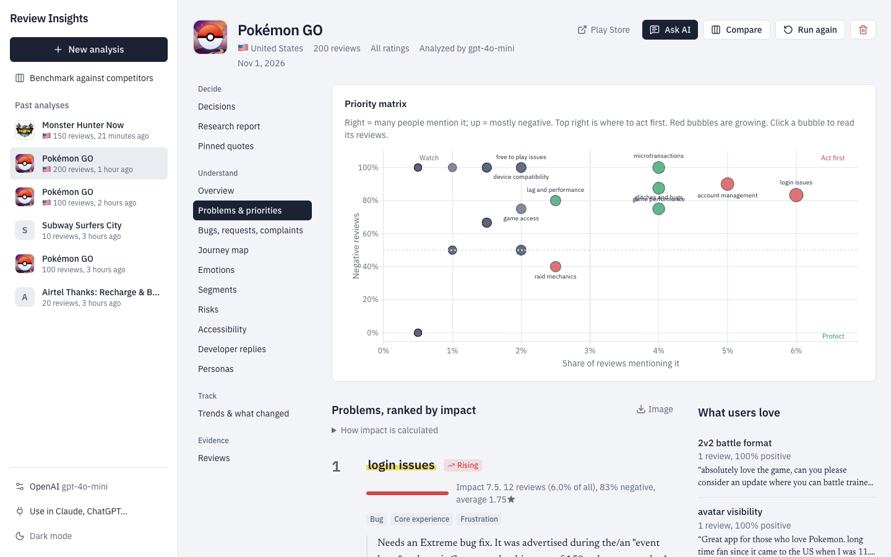
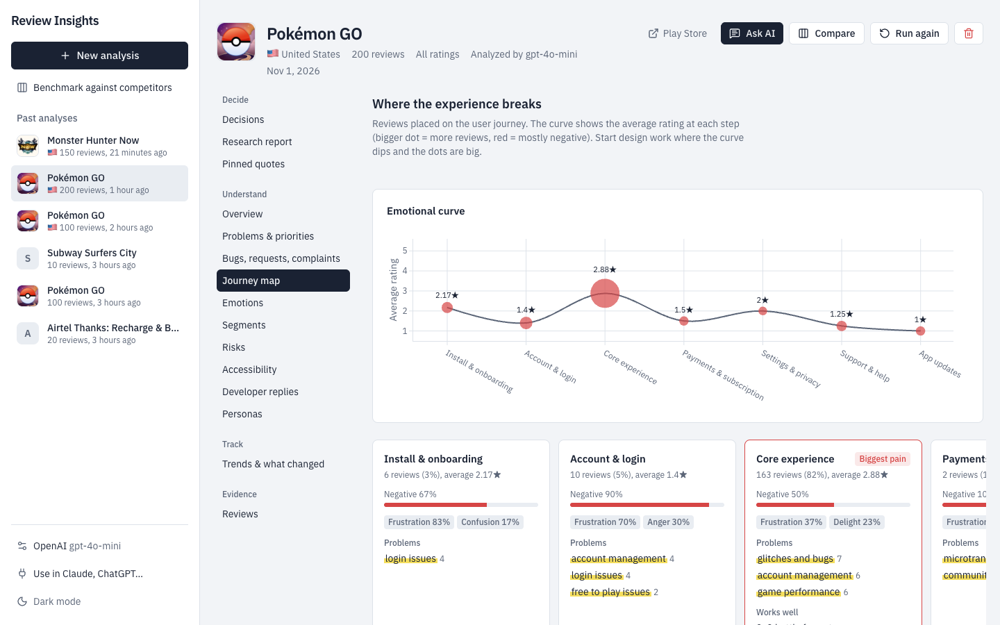
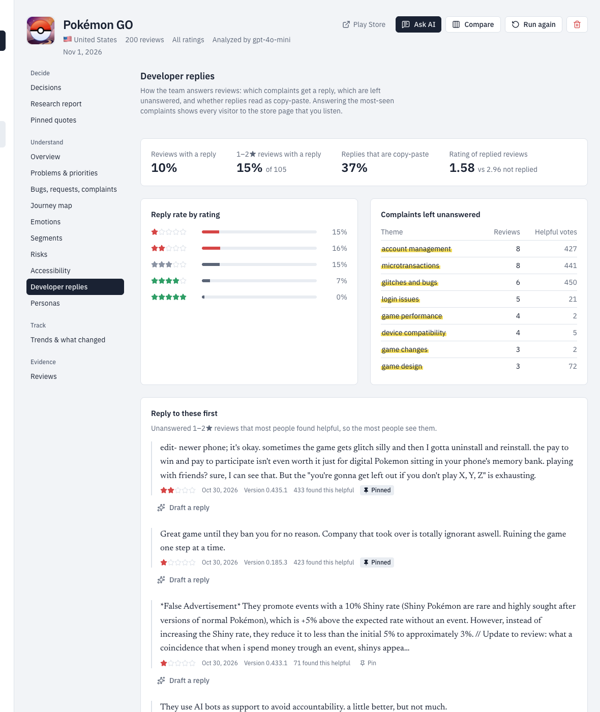
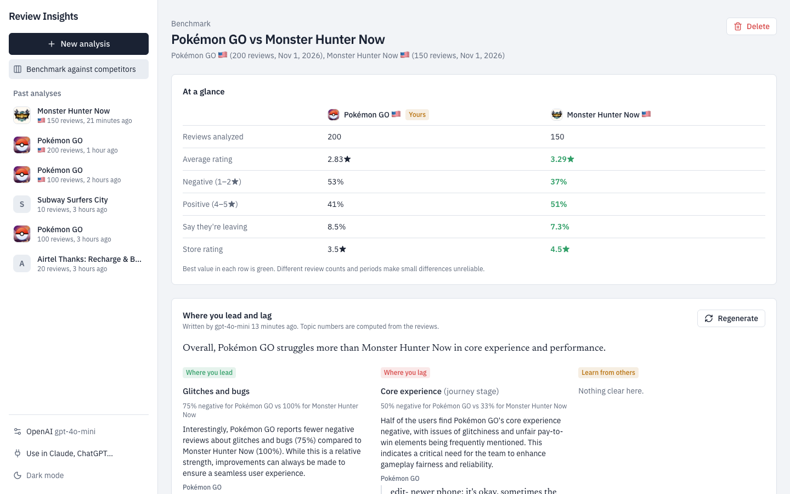
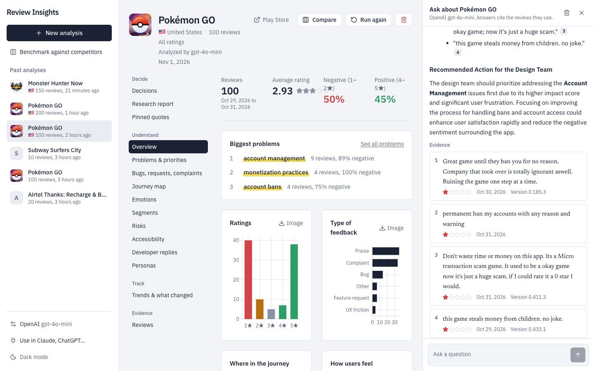
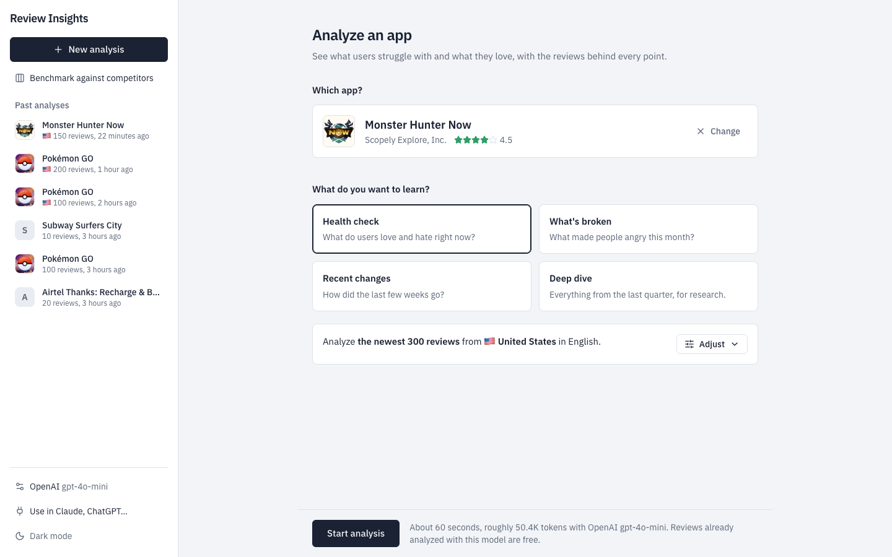

# Review Insights: turn Google Play reviews into design and product decisions

[](https://github.com/ux-biswarup/google-play-scrapper-for-designers/actions/workflows/ci.yml)
[](LICENSE)

**Review Insights is a free, open-source Google Play review analyzer for UX designers, product managers and
researchers.** Paste an app's name or Play Store link and get ranked decisions (what to fix, redesign, build or
protect), a journey map, a competitor benchmark and a shareable research report. Every point comes with the real
reviews behind it.

It runs on your computer and works with the AI you already use: Claude, ChatGPT, Gemini, OpenRouter, Groq,
Mistral, or a local model.



**Copyright © 2026 [Biswarup Mondal](https://www.biswarupmondal.com)**

## Why it exists

App reviews are the largest free source of user feedback a team has, and the least used. Reading thousands of them
takes days. Sentiment dashboards tell you that 40% are negative, but not what to change on Monday.

Review Insights reads every review for you, groups what people say, measures how much each problem matters, and
turns that into decisions you can defend in a design review or a roadmap meeting. Each one links back to the user's
own words.

## How it helps

**For product designers and UX researchers**
- See **where the experience breaks**: an emotional curve across onboarding, login, core use, payments and support.
- Get **usability problems ranked by impact**, not by how loud they are, with quotes for your next critique.
- Start research faster with **How Might We questions**, likely root causes and draft **proto-personas**, clearly
  marked as hypotheses.
- Find **accessibility barriers** that users report, each with the WCAG check to run.
- **Pin quotes** while you explore and drop them straight into decks, tickets and the research report.

**For product managers**
- A **Now / Next / Later** list of decisions, prioritized by impact × confidence ÷ effort, with a status you can track.
- **What changed in the latest release**: what got better or worse, with the labels computed from the numbers.
- **Early warnings**: users who say they're leaving and why, competitors they mention, payment problems.
- **Benchmark against competitors** to see where you lead, where you lag and what to learn from them.
- **Developer replies**: which complaints go unanswered, how much of your reply text is copy-paste, and AI reply
  drafts that fit Google Play's 350-character limit.

## The decision intelligence layer

Most AI review tools ask a model to "summarize the reviews", and you get confident text you can't check. Review
Insights splits the work so you can trust the result:

1. **Evidence.** The AI tags each review: feedback type (bug, request, friction, complaint, praise), themes, journey
   stage, emotion, severity, user type, churn risk and accessibility. Risky tags are double-checked: "they're leaving"
   and competitor names are kept only when the review says so in its own words.
2. **Analysis, computed in code.** Counts, shares, trends and scores are calculated, not written by the model.
   Impact = reach × negativity × momentum. Priority = impact × confidence ÷ effort. Better/worse labels, leads and
   lags come from the numbers.
3. **Decisions, written by AI and checked.** The model explains and recommends, citing review IDs. Citations to
   reviews that don't exist are removed, so every claim points to real feedback.

## Features

### Decide
- **Decisions:** ranked fix, redesign, build, reconsider and protect decisions, each with evidence, root causes,
  options, a metric to watch and a status.
- **Research report:** a UX research report with method, key findings, user needs, opportunities and quotes. You can
  download it as Markdown or print it to PDF.
- **Pinned quotes:** your evidence wall, with notes. Pins are added to the report.

### Understand
- **Overview** and **Problems & priorities**, with a priority matrix (reach × negativity).
- **Bugs, requests, complaints:** what to fix, what to build, what to redesign, what to reconsider.
- **Journey map**, **Emotions** (and what each feeling implies), **Segments** (new vs long-time vs paying users,
  versions, helpful votes, replied or not), **Risks**, **Accessibility**, **Developer replies**, **Personas**.







### Compare
- **Benchmark** 2 to 4 analyses: your app against competitors, two markets or two periods. The AI groups each app's
  themes into shared topics. Leads, lags and lessons are computed from the reviews, and each comes with a quote from
  both sides.



### Track and explore
- **Trends & what changed:** sentiment over time, one-star spikes, rising themes, before and after a release.
- **Any period:** the last 7, 30 or 90 days or a custom range. The app counts the reviews in that period first, so
  you choose how many to analyze.
- **Review explorer:** filter by rating, theme, type, journey stage, emotion, version or text.
- **Research assistant:** ask questions in plain language. Answers look up the analysis and cite the exact reviews.
- **Chart images** (PNG/SVG) for slides.



### Start in seconds
Pick an app, choose what you want to learn (health check, what's broken, recent changes or a deep dive) and start.
Market, language and sample size have sensible defaults; adjust them if you need to.



## Bring your own AI

Choose a provider and model in Settings:

- **API key:** Anthropic (Claude), OpenAI, Google Gemini, OpenRouter, Groq, Mistral, or any OpenAI-compatible server
- **Local and free:** Ollama
- **Sign in instead of pasting a key:** "Continue with ChatGPT" (uses a ChatGPT Plus/Pro plan; preview) or
  "Connect OpenRouter"

### Use your analyses inside Claude, ChatGPT, Cursor and other AI apps
The built-in [MCP](https://modelcontextprotocol.io) server lets Claude Desktop, Claude Code, Cursor, VS Code,
Codex and ChatGPT read your analyses with their own subscription. Ask them to compare apps, pull quotes or draft a
spec. The app's "Use in Claude, ChatGPT…" page has copy-paste setup for each one.

## Privacy and security

- **Runs locally.** Reviews and results are stored on your computer (`data/app.db`). Reviews are sent only to the AI
  provider you choose.
- **API keys never live in the browser.** Keys you paste are encrypted by the backend in `data/secrets.enc`. The
  encryption key is kept in your operating system's keychain (macOS Keychain, Windows Credential Manager, Linux
  Secret Service), or in an owner-only file where no keychain exists. The app only ever shows a masked hint. Choose
  "this session only" to keep a key in memory until the app stops. ChatGPT sign-in tokens are encrypted the same way.
- The server answers only on local host names and refuses changes requested by other websites, so a page open in
  your browser can't use your saved keys. App pages use a strict Content-Security-Policy.
- The MCP endpoint only accepts local requests unless you set `MCP_ALLOWED_HOSTS`.
- `.env` and other credential files are git-ignored. You can install a pre-commit hook that blocks committing them:
  `cp .github/pre-commit-hook.sh .git/hooks/pre-commit && chmod +x .git/hooks/pre-commit`

## Quick start

Requires Python 3.11+ and Node.js 24 (`nvm use` reads `.nvmrc`).

```bash
git clone https://github.com/ux-biswarup/google-play-scrapper-for-designers.git
cd google-play-scrapper-for-designers

python -m venv .venv && source .venv/bin/activate
pip install -r requirements.txt

cd web && nvm use && npm install && npm run build && cd ..
uvicorn backend.main:app --port 8000
```

Open http://127.0.0.1:8000, connect an AI model in Settings, and analyze an app by name or Play Store link.

Optionally, put fallback keys in `.env` (`ANTHROPIC_API_KEY`, `OPENAI_API_KEY`, `GEMINI_API_KEY`,
`OPENROUTER_API_KEY`, `GROQ_API_KEY`, `MISTRAL_API_KEY`) and a preselected model per provider (`OPENAI_MODEL`, …).
Analyses made with the earlier Streamlit version can be imported from `reports/` with
`python -m backend.cli import-legacy`.

## FAQ

**Is it free?**
Yes. Review Insights is open source (MIT). You pay only your AI provider for the tokens you use, or nothing with a
local model or an existing ChatGPT plan. The app shows an estimate before each analysis, and reviews already
analyzed with the same model are reused for free.

**How many reviews can it analyze?**
Up to 2,000 per analysis. For a period, it scans up to 10,000 reviews to count what's there, then you choose how
many to analyze: the newest, or spread evenly across the period.

**Which languages and countries?**
Any Google Play market and review language. Insights can be written in a different language from the reviews.

**Does it support the Apple App Store?**
Not yet; iOS reviews are next on the roadmap.

**How is this different from a sentiment dashboard?**
Sentiment tells you how people feel. Review Insights tells you what to do about it, how much it matters, and shows
the reviews that prove it.

**Can I share the results?**
Download the research report as Markdown, print any view to PDF, export charts as PNG/SVG, copy pinned quotes, or
give your team access through the MCP server in their own AI apps.

## Roadmap

- iOS App Store reviews
- Scheduled re-analysis with alerts when a problem spikes
- Exports to Jira, Linear and Notion

## Develop

- Frontend with hot reload: `cd web && npm run dev`, then open http://localhost:5173 (it proxies `/api` to the
  backend)
- API docs: http://127.0.0.1:8000/docs
- MCP server over stdio: `python -m backend.mcp_server`; over HTTP: `http://127.0.0.1:8000/mcp/`
- Tests: `pytest` (offline, no API keys needed). Lint: `ruff check backend tests` and `ruff format backend tests`
- CI runs lint, tests on Python 3.11–3.14, the frontend build and a smoke test of the running server

| Folder | What's in it |
| --- | --- |
| `backend/` | FastAPI app, AI providers, analysis pipeline, metrics layer, decision views, benchmarks, assistant tools, MCP server |
| `web/` | React + TypeScript + Vite + Tailwind interface with Plotly charts |
| `tests/unit/` | Offline tests with a fake Play Store and a fake AI model |

## License

MIT. See [LICENSE](LICENSE).
